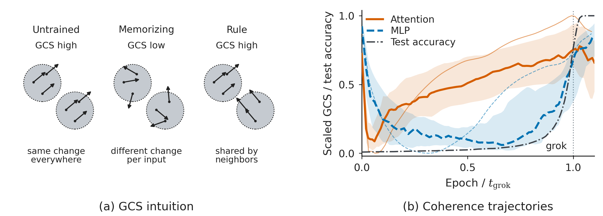

# Where to Look First in Grokking

Code for **Where to Look First in Grokking: Attention and MLP Coherence in Modular Arithmetic** (NeurIPS 2026).

Ruian Lei, Ruoxi Jiang, Marley M. B. R. Vellasco, M. Tanveer, and Zenglin Xu.

How does a network move from memorizing examples to learning a reusable rule for unseen input pairs? We study grokking in modular arithmetic, asking where in the network, and when during training, to look for the changes that accompany generalization.

Geometric Coherence Score (GCS) compares local responses across neighboring inputs, separately for attention and MLP outputs. It gives a retrospective view of training using a reference defined by the final model, without first reconstructing the learned algorithm.

[Figures and tables](#reproduce-figures-and-tables) · [GCS and interventions](#measure-gcs-and-reset-a-component) · [Training](#train-a-model) · [Paper result index](docs/coverage.md)



## Installation

Use Python 3.11. The figure and table commands run on CPU with the dependencies below; model experiments have an additional installation step.

```bash
git clone https://github.com/ryannL057/grokking-gcs.git
cd grokking-gcs
python3.11 -m venv .venv
source .venv/bin/activate
python -m pip install -r requirements/cached.txt
python -m pip install --no-deps .
```

## Reproduce figures and tables

Start with Figure 1 and Table 1:

```bash
python scripts/verify_artifacts.py
python scripts/reproduce.py --target fig01 --target tab01 --output outputs/quickstart
```

The command reads the bundled numerical results and writes Figure 1 as PDF, PNG and SVG, and Table 1 as CSV and JSON. Summing the table's depth rows gives 94/104 runs meeting the attention criterion, 103/104 meeting the MLP criterion, and 93/104 meeting both.

Use `python scripts/reproduce.py --list` to find another result, then select it with `--target`. Choose a new output directory each time. The [paper result index](docs/coverage.md) maps IDs to figures, tables and appendix analyses; the [reproduction guide](docs/reproduction.md) explains the calculations and output reports.

## Measure GCS and reset a component

Install the model dependencies, then analyze the included GELU addition model:

```bash
python -m pip install -r requirements/models.txt
python scripts/analyze.py --checkpoint examples/checkpoints/t_minus.pth \
  --config examples/checkpoints/config.json --geometry examples/checkpoints/geometry.npz \
  --output outputs/example-gcs
python scripts/intervene.py --host examples/checkpoints/final.pth \
  --donor examples/checkpoints/t_minus.pth --config examples/checkpoints/config.json \
  --output outputs/example-reset
```

The first command measures GCS using the saved reference geometry. The second replaces the final model's attention or MLP parameters with those from an earlier checkpoint and measures test accuracy:

| Model | Test accuracy |
|---|---:|
| Final checkpoint | 1.00000 |
| Attention reset | 0.25719 |
| MLP reset | 0.93679 |

The example includes three checkpoints, geometry and metadata, totaling 7.24 MiB. Expected scores and tolerances are in [expected.json](examples/checkpoints/expected.json). Add `--device cuda:0` to use a GPU. See [numerical conventions](docs/methods.md) for the path definitions, precision and reference construction.

## Train a model

Check the training loop with a five-epoch demo:

```bash
python scripts/train.py --config configs/demo.json --output outputs/demo
```

For a paper experiment, inspect the configuration before starting the full run:

```bash
python scripts/train.py --list
python scripts/train.py --run 1l_gelu_add_s42 --dry-run
python scripts/train.py --run 1l_gelu_add_s42 --device cuda:0 \
  --output data/experiments/gelu_1layer_add_p113_s42_20260301_041540
```

Named runs save checkpoints and compute GCS at the epochs specified in their manifests. The demo checks execution; full runs take substantially longer. The [experiment guide](docs/experiments.md) covers the training schedules, ablations and intervention protocols.

## Data and reproducibility

The saved results support 14 figures, 15 tables and eleven appendix analyses. The 104 training configurations include 87 saved configs and 17 reconstructed from model metadata and paper settings. The full historical training cohort was not rerun when preparing this repository, and its roughly 45 GiB of checkpoints are not bundled.

One response-norm control remains incomplete: its historical summary is included, but the original 19,200 per-response values and generating code have not been located. The reported minimum of 0.135 is therefore not independently verified here. The full reproduction check reports **40 passed, one incomplete**. See [coverage and limitations](docs/known_gaps.md), [data provenance](docs/data.md), and the [verification record](verification/REPORT.md).

## Open directions

GCS was designed as a manifold version of the [linear mapping number](https://arxiv.org/abs/2310.05918): instead of testing linearity along straight lines between inputs, it compares local responses along tangent directions among neighboring inputs. Several parts of that extension remain open, and the bundled results are enough to start on most of them.

- **Transport the probes.** Tangent directions are estimated from final-model block outputs but applied directly in input-embedding coordinates (Section 2.2). Pulling them back through the block, or estimating tangent spaces on the input side, would give a geometrically consistent probe. Probes are built in `src/gcs/analysis/reference_geometry.py`.
- **Compare response subspaces without matching bases.** Probes at neighboring inputs are paired by singular-value rank. With Procrustes matching, none of eight pilot runs shows MLP recovery before grokking (Appendix B.3). Principal angles between the response subspaces at two inputs would remove the pairing step. Alignment scores are in `src/gcs/analysis/gmn_tsa.py` and the edge matrix in `src/gcs/analysis/batched_gcs.py`.
- **Count distinct local maps.** GCS scores only neighbor edges, so the untrained network and a learned rule both score high (Figure 1a). Scoring all pairs and counting the effective number of distinct maps, as the linear mapping number does, should separate one map everywhere, one map per input and a few shared maps.
- **Check against the known algorithm.** Attention coherence and restricted Fourier progress share a training trend, but their step-to-step changes correlate weakly (median 0.034, Table 14). Testing whether a count of local maps follows the key frequencies would show what the score measures. The five addition runs are in the `compare_gcs_nanda_measures` experiment.
- **Use task-defined neighbors.** Final-model neighbors share the input's answer (Appendix B.5). Neighbors defined by the task itself, such as (a±1, b) and (a, b±1), would remove the dependence on a trained reference.
- **Compare with tangent-kernel measures.** Component-resolved kernel–label alignment ([Baratin et al., 2021](https://arxiv.org/abs/2008.00938)) or within-class gradient agreement ([Fort et al., 2019](https://arxiv.org/abs/1901.09491)) has not been computed on the same checkpoints.
- **Separate dependence from necessity.** In one-layer addition and multiplication runs, resetting attention to t⁻ costs the final model more accuracy than resetting the MLP, yet training with attention fixed at t⁻ still reaches 99% in 17/17 runs. Pairing endpoint resets with fixed-component continuation at the same stage applies to other components and tasks. Fixed MLPs receive no weight decay (Appendix D.4), which a decay-matched control should separate. Start with `scripts/intervene.py` and `scripts/freeze.py`.

## Citation and license

```bibtex
@inproceedings{lei2026where,
  title = {Where to Look First in Grokking: Attention and MLP Coherence in Modular Arithmetic},
  author = {Lei, Ruian and Jiang, Ruoxi and Vellasco, Marley M. B. R. and Tanveer, M. and Xu, Zenglin},
  booktitle = {Advances in Neural Information Processing Systems},
  year = {2026}
}
```

Code, configurations and documentation use [MIT](LICENSE). Numerical results and example weights use [CC BY 4.0](LICENSE-DATA); see [license scope](LICENSING.md) for details. We build on the MIT-licensed TransformerLens Grokking Demo and retain its notice. GrokAlign comparisons use our implementation of the cited method. Full credits are in [THIRD_PARTY.md](THIRD_PARTY.md).
